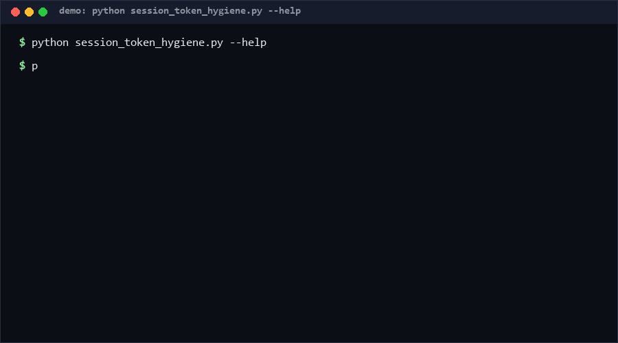

# session-token-hygiene

Audit a JSON token policy the way a security reviewer would. The checker grades every declared token (access, refresh, api_key) against TTL ceilings, refresh-vs-access consistency, rotation and scope hygiene, and exits non-zero on FAIL findings so CI can gate. Over-lived sessions are one config typo away; this makes it loud. Pure Python, standard library only.

As of 2026-10-13, no direct equivalent found as of 2026-10-13: auth frameworks embed their own defaults, but searches across GitHub (194 queries) and the web found no standalone policy-declaration hygiene checker with TTL ceilings and exit-code gating.

<p align="center"></p>

## Problem

Token lifetimes creep. Someone sets the access TTL to a week "temporarily", a refresh token outlives its paired access token, an `api_key` gets no rotation plan, a wildcard `*` scope sneaks into a service token. Each is invisible in a diff and none has a failing test. Policy review happens once, at design time; configuration drift happens continuously.

## How it works

1. **Input.** A policy file: `{"tokens": [{"name", "kind": "access|refresh|api_key", "ttl_seconds", "refreshable", "rotate_on_use", "scopes": [...]}]}`.
2. **Rules (graded FAIL/WARN).** `H001` missing/non-numeric TTL (F) · `H002` access TTL over ceilings (W > 1 h, F > 24 h, tunable) · `H003` refresh TTL ≤ paired access TTL (F) · `H004` refresh TTL > 90 days (F) · `H005` api_key without positive TTL / very long (F/W) · `H006` wildcard `*` scope (F) · `H007` duplicate names (F) · `H008` refreshable access without `rotate_on_use` (W) · `H009`–`H014` kind/name/scopes shape errors.
3. **Exit contract.** Exit 0 (warnings allowed), 1 on any FAIL, 2 on malformed input — wire directly into CI.
4. **JSON output.** `--json` yields `{summary: {fails, warns, tokens_checked}, findings: [...]}` for dashboards.

## Quickstart

Requires Python 3.8+. No dependencies. Checking a 5,000-token policy takes ~0.01 s [Measured].

```bash
python session_token_hygiene.py check policy.json
python session_token_hygiene.py check policy.json --json
python session_token_hygiene.py check policy.json --max-access-warn 1800 --max-access-fail 43200
```

Example policy: `{"tokens": [{"name": "web-session", "kind": "access", "ttl_seconds": 900, "refreshable": true, "rotate_on_use": true, "scopes": ["read"]}]}`

## Why not X

- **Auth-framework defaults** (OAuth libraries): they enforce defaults inside the framework but cannot audit a *declared* policy across vendors, nor fail CI on drift.
- **SAST/secret scanners**: they hunt leaked credentials, not misconfigured lifetimes; a 30-day access token in a config file is invisible to them.
- **CSP/IAM policy linters**: operate on cloud IAM documents, not application session/token declarations; different layer, different schema.
- **Manual security review**: thorough but periodic; this runs on every commit.

No direct equivalent found as of 2026-10-13 for a stdlib-only token-policy hygiene gate.

## Performance

Measured on Windows 10, Python 3.13, single core:

| Workload | Time | Reproduce |
|---|---|---|
| 5,000-token policy [Measured] | 0.008 s | `python -c "import time,session_token_hygiene as s; p={'tokens':[{'name':'t%d'%i,'kind':'access','ttl_seconds':600,'scopes':['read']} for i in range(5000)]}; t=time.perf_counter(); s.check_policy(p); print('%.4fs'%(time.perf_counter()-t))"` |
| typical 10-token policy [Measured] | < 0.01 s | `python session_token_hygiene.py check policy.json` |

## Minimal Fallback

No Python? Load the policy into a spreadsheet with columns `name, kind, ttl_seconds` and add three checks: access TTL ≤ 3600, refresh TTL > access TTL, refresh TTL ≤ 7776000. That reproduces rules H002/H003/H004 but not scope, naming, or rotation rules — and nothing fails CI.

## Design Trade-offs

- **Ceilings are opinions.** 1 h warn / 24 h fail for access tokens defaults to mainstream guidance; every ceiling is a CLI flag for local override.
- **Pairing by name convention** (`access_x` ↔ `refresh_x`). Zero-config but only catches matched names; explicit pair IDs are a possible v0.2 field.
- **Static audit, not runtime.** It reads declarations; it cannot detect a runtime that ignores them.
- **Wildcard scope is a hard FAIL.** Blunt but deliberate — `*` in a service token is almost always unintended.

## Limits & Second-order Effects

- A clean policy file does not make a clean system: storage encryption, revocation endpoints and logout semantics are out of scope.
- Teams may tune ceilings down to pass instead of fixing lifetimes — the WARN/FAIL split exists so stretching warns is visible in reports.
- api_key rotation is checked as declaration only; actual key rollover needs runtime evidence.
- Adding rules over time can flip previously-clean repos to FAIL; pin the tool version in CI and adopt rule changes deliberately.

## FAQ

**When NOT to use this?** Not for evaluating a live identity provider (point it at the *declaration*, not the endpoint), not for TLS/certificate lifetimes, and not as a substitute for a pen test.

**Why WARN at 1 hour for access tokens?** Mainstream OAuth guidance caps access tokens at minutes-to-an-hour; exceeding it is worth a note, not a gate.

**Can I check multiple policies?** Run the command per file; combine JSON outputs in your CI summary.

**Does it support expiry *dates* instead of TTLs?** Not in v0.1; `ttl_seconds` is the declared schema.

## [Core Assumptions]

- **Shorter access-token lifetimes reduce blast radius** of theft. Confidence: high.
- **Policies are declared in machine-readable JSON** somewhere auditable. Confidence: high for this repo's contract.
- **FAIL findings should block CI.** Confidence: medium-high — teams can downgrade by editing ceilings, but the default errs safe.
- **Name-convention pairing approximates real token pairs.** Confidence: medium.

As of 2026-10-13.

---

Part of the [zhengming-toolbox](https://github.com/chenhz01/zhengming-toolbox) — 105 purpose-built AI-engineering tools across neglected niches.

Related tools: [docs-info-leak-scan](https://github.com/chenhz01/docs-info-leak-scan) · [data-classification-schema](https://github.com/chenhz01/data-classification-schema) · [file-permission-drift](https://github.com/chenhz01/file-permission-drift)
